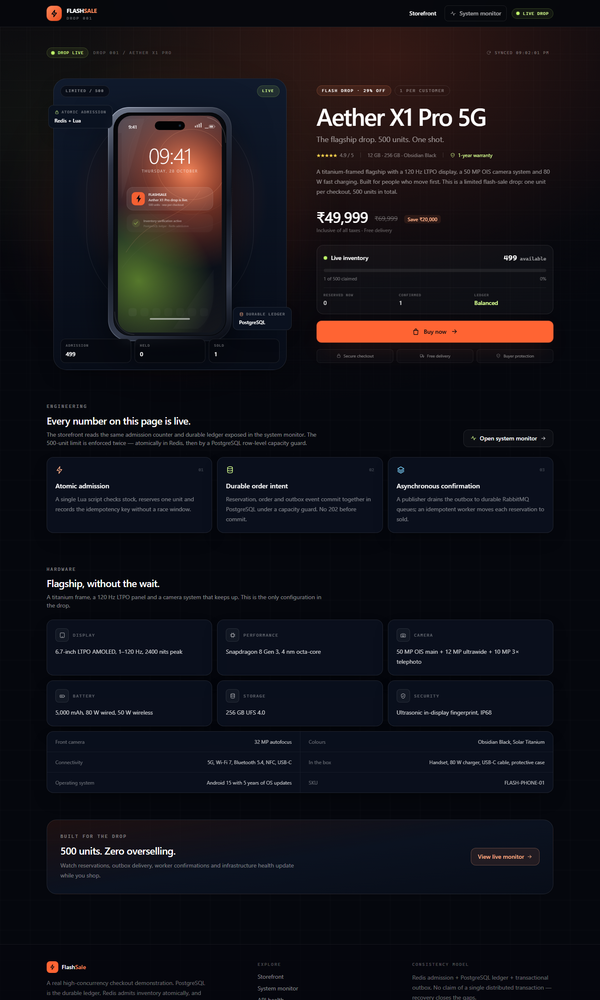
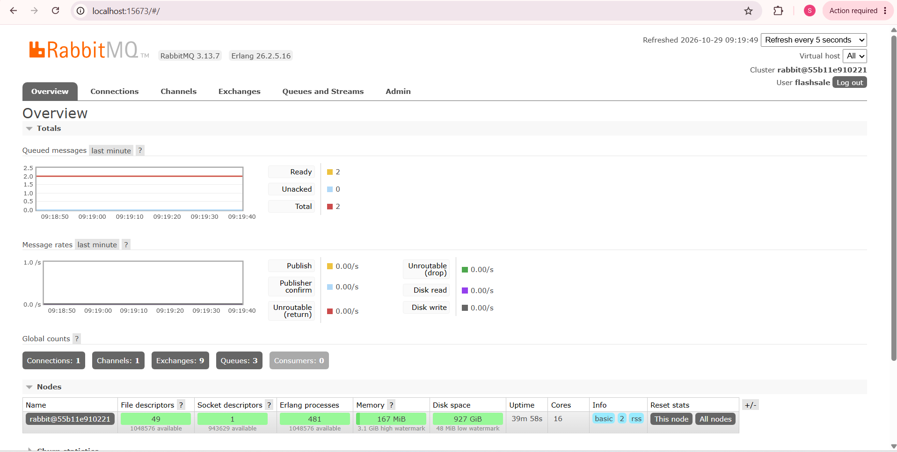

# FlashSale

A complete high-concurrency flash-sale checkout system: 500 units, one unit per
successful checkout, and a hard zero-overselling guarantee. The API returns
`202 Accepted` only after the reservation, order and transactional-outbox row are
durably committed to PostgreSQL. Redis makes admission fast, RabbitMQ moves
accepted orders to a worker, and every layer is observable from the UI.

The repository contains a React storefront, an order-tracking page, a live system
monitor, an Express/Zod API, a Prisma/PostgreSQL ledger, Redis/Lua admission,
RabbitMQ outbox publishing and an idempotent worker. It was built and verified on
Windows with Node 22, PostgreSQL 16, Redis 7 and RabbitMQ 3.13.

Flash-Sale UI

RabbitMQ


## What is guaranteed

- **Exactly 500 units, never 501.** Redis atomically admits at most 500 requests.
  PostgreSQL independently enforces `reservedStock + soldStock + initialStock`
  bounds and a transaction-level capacity guard, so a stale or flushed Redis can
  never create an extra order.
- **202 means durable.** A 202 response is sent only after one PostgreSQL
  transaction commits the `ACTIVE` reservation, `PENDING` order and `PENDING`
  outbox event together.
- **One unit per checkout.** Quantity is fixed at 1 in the API, schema and checks.
- **Mandatory idempotency.** Every checkout needs an `Idempotency-Key`. Replays
  return the original order; the same key with a different payload is rejected
  with `409 IDEMPOTENCY_MISMATCH`.
- **No double decrement.** Confirmation moves one unit from `reservedStock` to
  `soldStock` exactly once, under a row lock and reservation-status guard.
- **Accounting invariant.**
  `available + active reservations + confirmed = 500`, checked continuously by the
  monitor and at commit time by a deferred PostgreSQL trigger.
- **Orders reach a terminal state.** The outbox publisher uses publisher confirms
  and persistent messages; the worker retries, dead-letters and is idempotent.
  Recovery repairs expired reservations, failed Redis compensations, orphaned
  Redis admissions and lost outbox messages.

## Stack

| Layer | Technology |
| --- | --- |
| Storefront & monitor | React 18, TypeScript, Vite, Tailwind CSS |
| API | Node 22, Express, TypeScript, Zod |
| Durable ledger | PostgreSQL 16, Prisma |
| Admission | Redis 7, Lua scripts |
| Async processing | RabbitMQ 3.13, transactional outbox, publisher confirms |
| Tests | Vitest, Supertest, React Testing Library, custom concurrency harness, k6 |
| Runtime | Docker Compose, nginx |

## Quick start with Docker

```bash
cp .env.example .env
docker compose up --build
```

Open <http://localhost:8080>. The stack starts PostgreSQL, Redis, RabbitMQ, runs
migrations and the seed, then starts the API, outbox publisher, worker and nginx.
RabbitMQ management is available inside the Compose network; add a port mapping
if you need it from the host.

Useful commands:

```bash
npm run docker:up            # build and start the whole stack in the background
npm run docker:logs          # follow api, worker, outbox and web logs
npm run docker:down          # stop
docker compose down -v       # stop and delete the ledger volumes
```

The only host port is `WEB_PORT` (default `8080`); change it in `.env` if it is
already in use. `POSTGRES_PASSWORD`, `RABBITMQ_PASSWORD`, stock and rate limits are
also configurable there.

## Local development

Prerequisites: Node 22+, PostgreSQL 16+, Redis 7+ and RabbitMQ 3.13+.

```bash
npm run install:all
cp backend/.env.example backend/.env
```

Create the database, run migrations and seed:

```bash
npm --prefix backend run prisma:migrate
npm --prefix backend run seed
```

Start the three backend processes and the Vite dev server in separate terminals:

```bash
npm run dev:api       # http://localhost:3000
npm run dev:outbox
npm run dev:worker
npm run dev:web       # http://localhost:5173, proxies /api to :3000
```

### Configuration

The important backend variables are documented in `backend/.env.example` (local
development) and `.env.example` (Docker Compose). Defaults target local
development:

| Variable | Purpose |
| --- | --- |
| `DATABASE_URL` | PostgreSQL ledger |
| `REDIS_URL` | Admission Redis (use a dedicated DB) |
| `RABBITMQ_URL` | Broker connection |
| `RABBITMQ_MANAGEMENT_URL` | Queue-depth metrics for the monitor |
| `QUEUE_PREFIX`, `REDIS_KEY_PREFIX` | Namespace isolation between environments |
| `INITIAL_STOCK` | 500 for this sale |
| `RESERVATION_TTL_SECONDS` | How long a pending reservation can be confirmed |
| `WORKER_*`, `OUTBOX_*`, `RECOVERY_*` | Retry, batching and repair timing |
| `RATE_LIMIT_*` | Global and checkout throttles |

Tests use a separate environment automatically: database `flashsale_test`, Redis
DB 15 and the `flashsale_test` queue prefix. They never touch development data.

## Pages and APIs

- `/` — storefront with live stock, product details and the locked checkout modal.
- `/orders/:orderId` — durable order status with a timeline; server-sent events
  with a polling fallback. Personal data is masked.
- `/system-monitor` — inventory invariant, admission drift, outbox and queue
  depth, worker/database/Redis/RabbitMQ health, checkout counters, latency and
  recent activity. Missing metrics are labelled, never invented.

Public API:

| Method | Route | Notes |
| --- | --- | --- |
| `GET` | `/api/health` | Liveness |
| `GET` | `/api/products/flash-sale` | Product + live inventory |
| `POST` | `/api/checkout` | Requires `Idempotency-Key`; `202` / `409` |
| `GET` | `/api/orders/:orderId` | Masked order view |
| `GET` | `/api/orders/:orderId/events` | SSE; closes at terminal state |
| `GET` | `/api/monitor/overview` | Full monitor snapshot |
| `GET` | `/api/monitor/health` | Dependency health |
| `GET` | `/api/monitor/events` | Recent monitor events |

There is deliberately **no reset endpoint**. Resetting is an operator-only,
development script:

```bash
npm run db:reset:force
```

It refuses to run in production and refuses while orders or outbox events are
still processing. (`npm run reset:inventory:force` inside `backend/` is the same
thing; use the dedicated script because some npm versions on Windows drop
arguments passed after `--`.)

## Tests and real results

All numbers below are from actual runs on this machine (28 Oct 2026), not
estimates. Raw k6 output is in `docs/test-results-k6.txt`; the concurrency
harness output is in `docs/test-results-concurrency.txt`.

### Unit and integration tests

```bash
npm test                 # backend then frontend
npm run test:backend
npm run test:frontend
```

The suite creates, migrates and seeds `flashsale_test` automatically. To prepare
it explicitly, run `npm --prefix backend run test:setup`.

| Suite | Result |
| --- | --- |
| Backend (Vitest + Supertest, real PostgreSQL/Redis) | **27/27 passed** in 4 files |
| Frontend (Vitest + React Testing Library) | **8/8 passed** in 3 files |
| TypeScript (backend + frontend) | **passed** |
| Production builds | **passed** |

Backend coverage includes API validation, durable commit-before-202, replay,
payload mismatch, sold-out, the durable guard defeating an over-admitted Redis,
tracking/masking, monitor data, outbox claiming/failure/backoff, idempotent
confirmation, and all recovery paths.

### Mandatory concurrency verification

```bash
npm --prefix backend run test:concurrency
```

The harness resets the isolated test ledger to 500 units, starts the real Express
app, fires **1,000 concurrent checkouts with unique Idempotency-Keys**, then runs
the real outbox publisher and RabbitMQ worker. The final run produced:

| Check | Actual result |
| --- | --- |
| Concurrent unique-key checkouts | 1,000 |
| `202` accepted | **500** |
| `409 SOLD_OUT` | **500** |
| Other HTTP statuses / network errors | **0** |
| Durable orders / reservations / outbox rows | **500 / 500 / 500** |
| Orders after worker | **500 CONFIRMED, 0 FAILED, 0 PENDING** |
| Reservations | **500 CONFIRMED, 0 ACTIVE** |
| Final ledger | **0 available + 0 reserved + 500 sold = 500** |
| Invariant | **holds** |
| Outbox | **500 PUBLISHED, 0 failed** |
| Main / retry / dead-letter queues | **0 / 0 / 0 ready** |
| Concurrent idempotent replays | **50/50** returned the original order, no extra decrement |
| Checkout wall time | **6.81 s** for 1,000 requests (~147 req/s) |
| Latency p50 / p95 / p99 / max | **5.63 / 6.61 / 6.62 / 6.79 s** |

The high percentile is expected: all 1,000 requests are dispatched at once and
the client keeps at most 128 sockets open, so queueing time dominates. The
important result is that exactly 500 requests were durably accepted and the
ledger stayed exact.

### k6 load test

```bash
# Start the API with 500 units available, then:
docker run --rm -v "${PWD}/load-tests:/scripts" \
  -e BASE_URL=http://host.docker.internal:3000 \
  grafana/k6 run /scripts/flash-sale.js
```

Actual result: **1,200 iterations across 200 VUs**, **500 accepted**, **700
`SOLD_OUT`**, **0 unexpected**, 100% checks passed, p95 3.13 s, total run 8.9 s.
See `load-tests/flash-sale.js` for thresholds and configuration.

### Docker Compose smoke test

The full Compose stack was built and started successfully, then exercised through
nginx: web returned `200`, a checkout returned `202`, the tracking page reached
`CONFIRMED`, the monitor reported `499 available + 0 reserved + 1 confirmed = 500`,
and the outbox published the event. Raw snapshot: `docs/test-results-compose.txt`.

## Repository layout

```text
backend/
  prisma/                 schema, migrations, seed
  src/
    inventory/            Redis/Lua admission + durable inventory snapshot
    services/             checkout boundary, order processing, outbox
    workers/              RabbitMQ consumer, recovery sweeper
    monitoring/           overview, health, queue metrics
    routes/               products, checkout, orders, monitor
  tests/                  integration tests + mandatory concurrency harness
frontend/
  src/pages/              storefront, order tracking, system monitor
  src/components/         checkout modal, navigation, UI primitives
  src/tests/              RTL tests
load-tests/flash-sale.js  k6 scenario and thresholds
docs/architecture.md      design, consistency argument, failure handling
docker-compose.yml        PostgreSQL, Redis, RabbitMQ, API, worker, outbox, nginx
```

## Design notes and limitations

- Redis and PostgreSQL are **not** one distributed transaction. Redis is an
  admission gate; PostgreSQL is the source of truth. The gap is handled by
  compensation, the recovery sweeper and the durable capacity guard. This is
  documented in detail in [`docs/architecture.md`](docs/architecture.md).
- The monitor's queue depth relies on the RabbitMQ management API. If that API is
  unavailable, the UI shows `Unavailable` rather than a guessed number.
- SSE falls back to polling after repeated connection failures. Order data is
  masked; the full address and email are never returned by public endpoints.
- The local Docker run used `WEB_PORT=8090` to avoid an occupied host port. The
  Compose defaults are otherwise unchanged.
- During load testing, the first run exposed two real issues that were fixed:
  a deferred trigger that read multiple snapshots under concurrency (now a single
  statement), and a too-short Prisma transaction wait under 200-VU load (now
  `maxWait: 15s`, `timeout: 30s`). The results above are after those fixes.
