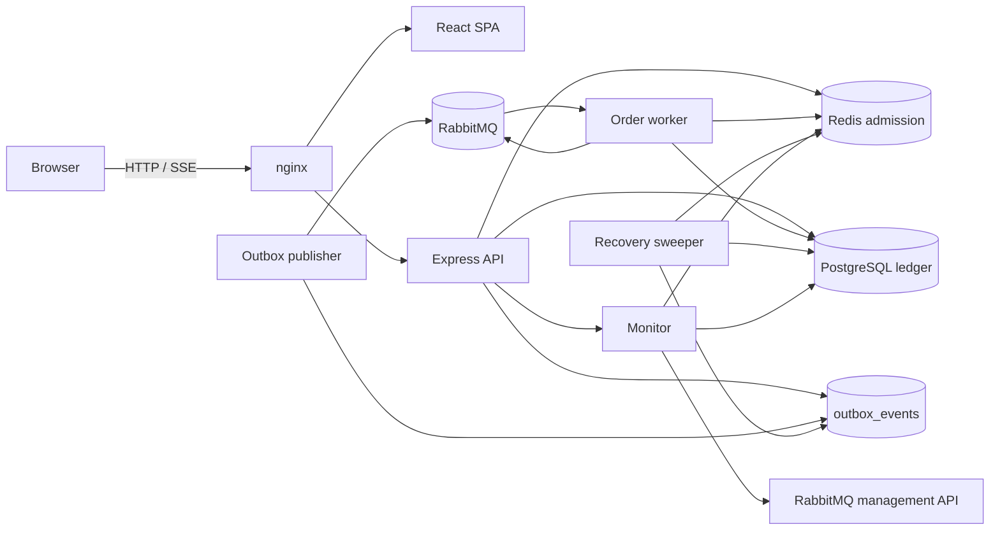

# FlashSale architecture

This document explains how the system keeps 500 units exact under concurrency,
where the consistency boundaries are, and what happens when a dependency fails.

## 1. Components



- **React SPA** — storefront, locked checkout modal, order tracking and the system
  monitor. Served by nginx, which also proxies `/api` and disables buffering for
  SSE.
- **Express API** — validation, idempotency, Redis admission, the PostgreSQL
  checkout transaction and read APIs.
- **PostgreSQL** — the durable source of truth. It stores the product ledger,
  reservations, orders and the transactional outbox.
- **Redis** — fast admission and idempotency cache. Its unit counter is an
  optimization, not the ledger.
- **RabbitMQ** — durable order-reserved messages, retry queue and dead-letter
  queue. Publisher confirms are required before an outbox row is marked
  published.
- **Order worker** — consumes messages, confirms orders under a row lock, retries
  transient failures and dead-letters poison messages.
- **Recovery sweeper** — repairs gaps between Redis and PostgreSQL and requeues
  lost outbox events.
- **Monitor** — aggregates real signals; missing signals are labelled.

## 2. The accounting model

`Product` carries three counters:

- `initialStock` — 500.
- `reservedStock` — units held by `ACTIVE` reservations.
- `soldStock` — units attached to `CONFIRMED` orders.

The invariant is:

```text
initialStock = availableStock + reservedStock + soldStock
availableStock = max(0, initialStock - reservedStock - soldStock)
```

The monitor additionally counts the actual rows:

```text
reservedStock    == number of ACTIVE reservations
soldStock        == number of CONFIRMED orders
```

This catches a drifting counter that would otherwise look healthy.

### Database hard guards

The `ledger_guards` migration adds:

1. Check constraints ensuring all counters are non-negative and
   `reservedStock + soldStock <= initialStock`, and `quantity = 1` on orders and
   reservations.
2. Deferred constraint triggers on `products`, `reservations` and `orders` that
   verify the counter/row invariant at commit.

The trigger is deferred so a transaction can update the product counter before or
after inserting the matching reservation/order. It reads the product counters and
both row counts **in a single SQL statement**, which gives all four values one
MVCC snapshot. An earlier version used separate statements and produced false
mismatches under concurrent commits; the 1,000-request run exposed that and the
`consistent_ledger_guard` migration fixed it.

The application also applies a row-level capacity guard inside the checkout
transaction:

```sql
UPDATE products
SET "reservedStock" = "reservedStock" + 1
WHERE id = $1
  AND "reservedStock" + "soldStock" + 1 <= "initialStock";
```

If zero rows are updated, the transaction is rolled back and the API returns
`409 SOLD_OUT`, even if Redis admitted the request. This is the last line of
defense against stale or over-admitted Redis state.

## 3. Checkout sequence

```mermaid
sequenceDiagram
    participant C as Client
    participant A as API
    participant R as Redis
    participant P as PostgreSQL
    C->>A: POST /api/checkout + Idempotency-Key
    A->>A: validate Zod payload and key
    A->>P: find order by idempotency key
    alt existing, same payload
        P-->>A: order
        A-->>C: 202 replayed=true
    else existing, different payload
        A-->>C: 409 IDEMPOTENCY_MISMATCH
    else new
        A->>R: Lua: check idempotency, decrement stock, write reservation
        alt no stock
            R-->>A: ERR_SOLD_OUT
            A-->>C: 409 SOLD_OUT
        else admitted
            R-->>A: SUCCESS_NEW + remaining
            A->>P: BEGIN
            A->>P: guarded UPDATE products
            A->>P: INSERT reservation (ACTIVE)
            A->>P: INSERT order (PENDING)
            A->>P: INSERT outbox (PENDING)
            A->>P: COMMIT
            alt commit succeeded
                A-->>C: 202 + order id
            else any failure
                A->>R: Lua compensation (idempotent)
                A-->>C: 409 or 503; no order is claimed
            end
        end
    end
```

The Redis Lua script checks idempotency before the counter, so a replay never
consumes a second unit. The durable PostgreSQL check runs first and is the final
arbiter after a Redis restart.

### Why 202 is meaningful

The response is constructed only after `prisma.$transaction` commits. That
transaction includes the reservation, order and outbox row. If the process dies
before commit, there is no order and Redis is compensated; if it dies after commit
but before responding, a retry with the same key finds the durable order and
replays it.

The transaction uses `maxWait: 15s` and `timeout: 30s`. The default 2-second wait
was too short for a 200-VU burst and produced spurious 503s in the first k6 run;
the load test was rerun after the fix.

## 4. Redis admission details

`reserveUnit` is one Lua script:

- `KEYS[1]` — stock counter.
- `KEYS[2]` — reservation hash, `orderId -> record`.
- `KEYS[3]` — idempotency record for this key.
- `ARGV[1..4]` — order id, payload hash, timestamp, idempotency key.

Returns:

| Result | Meaning |
| --- | --- |
| `SUCCESS_NEW` | unit decremented, reservation + idempotency stored |
| `SUCCESS_IDEMPOTENT` | same key/payload already admitted; no decrement |
| `ERR_IDEMPOTENCY_MISMATCH` | same key, different payload hash |
| `ERR_SOLD_OUT` | counter is zero or would go negative |
| `ERR_NOT_INITIALIZED` | counter missing; refuse rather than guess |

Compensation (`COMPENSATE_LUA`) removes the reservation hash entry, removes the
idempotency record only if it belongs to the same order, and increments the
counter only when the hash entry was actually removed. Repeating compensation is
therefore safe and cannot inflate stock.

`RESET_LUA` is only used by the development reset script, never over HTTP.

## 5. Transactional outbox and worker

The checkout transaction writes an `ORDER_RESERVED` outbox row in the same commit
as the order. The publisher:

1. Claims a batch with `FOR UPDATE SKIP LOCKED` and marks it `PUBLISHING`.
2. Publishes a persistent message to the durable exchange with publisher confirms.
3. Marks the row `PUBLISHED` only after the confirm.
4. On failure, increments attempts, stores the error and schedules exponential
   backoff; after `OUTBOX_MAX_ATTEMPTS` it becomes `FAILED` for operator attention.
5. Recovers claims stuck in `PUBLISHING` for more than 60 seconds.

The worker:

1. Parses the message and dead-letters malformed input.
2. Marks processing with `processingStartedAt` only once.
3. Locks the order row (`SELECT ... FOR UPDATE`).
4. Confirms only if the order is `PENDING`, the reservation is `ACTIVE` and not
   expired, and the reserved ledger can be decremented.
5. Moves `reservedStock -> soldStock`, marks the reservation and order `CONFIRMED`,
   and commits atomically.
6. Treats duplicate deliveries as a no-op and uses retry/backoff for transient
   failures.

The final confirmation is therefore idempotent even if RabbitMQ delivers the same
message more than once.

## 6. Failure handling and recovery

| Failure | Handling |
| --- | --- |
| Redis down during checkout | `503 INVENTORY_UNAVAILABLE`, no order created |
| Redis admits but PostgreSQL commit fails | Lua compensation restores the unit |
| API dies between Redis and PostgreSQL | Recovery releases the orphaned Redis reservation after a grace period |
| Redis flushed | Worker/recovery reseeds the counter from the durable ledger via `SETNX` semantics |
| Reservation expires | Recovery or worker marks the order `FAILED`, releases the reservation and compensates Redis |
| Compensation fails | Recovery retries it; the reservation row remains released so it is not double-released |
| RabbitMQ publish fails | Outbox stays `PENDING` with backoff, then `FAILED` after the limit |
| Message lost after publish | Recovery requeues a `PUBLISHED` outbox row whose order is still pending after 10 minutes |
| Worker transient error | Retry queue with exponential backoff, then DLQ |
| Poison message | Dead-letter queue; order is failed and compensated when attempts are exhausted |
| Duplicate message | `confirmOrder` sees a non-pending order and returns `duplicate` |

The recovery service also reports an admission drift in the monitor if Redis and
the durable ledger disagree.

## 7. Idempotency semantics

- Keys are 8–128 safe characters: `A-Z a-z 0-9 . _ : -`.
- PostgreSQL has unique constraints on `orders.idempotencyKey` and
  `reservations.idempotencyKey`.
- The payload hash normalizes trimmed/lowercased fields.
- Same key + same payload: `202` with `replayed: true` and the original order.
- Same key + different payload: `409 IDEMPOTENCY_MISMATCH`.
- A Redis outage does not lose idempotency: PostgreSQL is checked first.
- Concurrent duplicates are serialized by Redis Lua or by the unique constraint;
  the `P2002` path returns the existing order when the payload matches.

## 8. Monitoring and observability

`/api/monitor/overview` combines:

- Inventory counters, row counts, Redis admission, drift and invariant.
- Checkout counters from Redis with a per-process fallback.
- Order status counts and recent orders.
- Outbox status counts, oldest pending age, processed confirmations.
- Queue depth and consumers from the RabbitMQ management API, or a labelled
  `Unavailable` state.
- Recent monitor events from a capped Redis list.
- In-process latency samples (recent 500 requests), error count and throughput.

`/api/monitor/health` checks PostgreSQL (`SELECT 1`), Redis (`PING`) and the
RabbitMQ management API with latency. The UI labels the overall status
`healthy` or `degraded` (and never fabricates queue depth).

Public monitor APIs do not expose reset controls, credentials, raw addresses or
emails.

## 9. Testing strategy

- **Unit/integration (Vitest + Supertest, real PostgreSQL/Redis):** API contract,
  durable commit, replay, mismatch, sold-out, durable guard, outbox, worker
  outcomes and recovery.
- **Frontend (RTL):** loading, live stock, duplicate-submit lock, sold-out, backend
  failure, tracking terminal state, monitor metric rendering and unavailable
  metrics.
- **Concurrency harness:** 1,000 unique-key HTTP checkouts against the real app,
  then real outbox + worker, asserting the final ledger and terminal states.
- **k6:** 1,200 iterations over 200 VUs, with thresholds on accepted count,
  sold-out count, unexpected responses and latency.

The test environment is isolated: `flashsale_test` database, Redis DB 15 and the
`flashsale_test` queue prefix. The harness and k6 results are stored under
`docs/`.

## 10. Tradeoffs and limitations

- Redis admission is not part of the PostgreSQL transaction. Compensation and
  recovery close the gap; the durable guard makes overselling impossible at the
  cost of occasional 503/409 responses when a commit fails.
- Redis idempotency records and reservation hash entries persist for confirmed
  orders (bounded by the 500-unit sale). This is intentional: it makes replay and
  orphan detection cheap.
- The monitor's queue depths depend on the management API; if it is down, those
  cards say `Unavailable`.
- The system is sized for a single flash-sale product and one unit per checkout.
  The schema and guards encode that explicitly.
- Rate limits are intentionally permissive in Compose so the verification can run;
  reduce them for a public deployment.
- The API is stateless apart from in-process latency samples; multiple API replicas
  would each report their own latency window while sharing the Redis counters.
